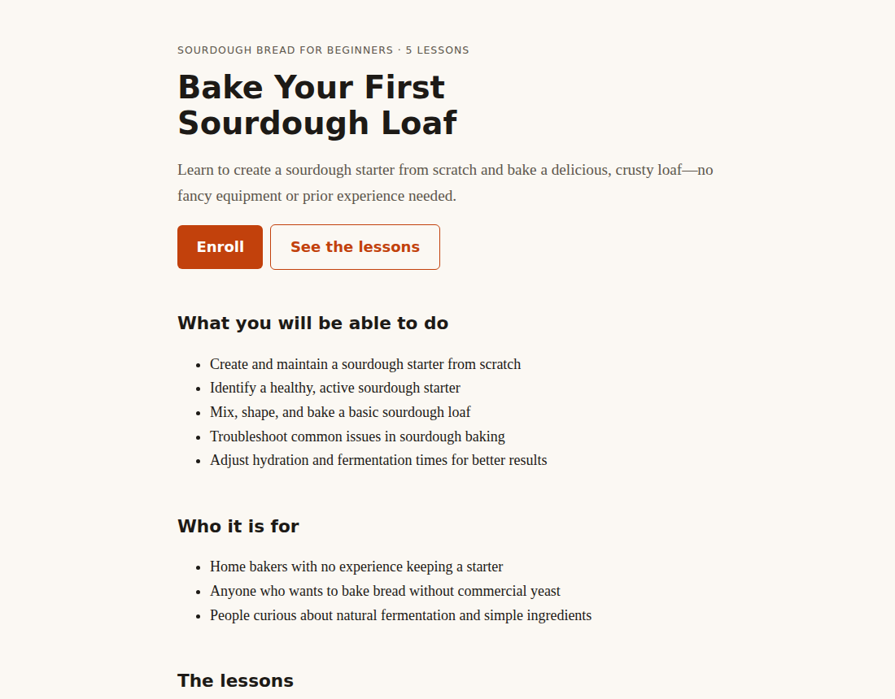

# course-forge

**One topic in. A complete online course out: lessons, quizzes, slides and a landing page, written by a model on your own machine and checked before you see it. Free.**

There's a post going around: launch your own course using AI in a weekend, comment a keyword for
the steps. Here are the steps, as code.

**[See an example course it wrote →](https://warboy176.github.io/course-forge/examples/sourdough/site/)**



## What it does

- **Plans the course.** One topic and an audience become a course title, 4 to 6 concrete outcomes
  and a lesson plan in which each lesson builds on the last.
- **Writes every lesson.** 700 to 1,000 words each, with sections, a worked example, a hands-on
  "Try it" exercise and a recap.
- **Quizzes the learner, and checks itself.** Four questions per lesson. The model then answers
  its own quiz from the lesson text without seeing the key, and any question where the key
  disagrees with the lesson, or the explanation contradicts the answer, is thrown back and rewritten.
- **Makes the slides.** A keyboard- and tap-driven deck per lesson, one HTML file each.
- **Builds the site.** A landing page with outcomes, who it's for, the syllabus and an FAQ, plus a
  page per lesson with its interactive quiz. Every internal link is checked; nothing loads from
  another server, so the `site` folder works on GitHub Pages, Netlify or any static host.
- **Exports the manuscript.** `course.md` holds the whole course in one file, answers included,
  ready to edit or to paste into a course platform.

Every stage is validated and re-asked with the exact problem when it fails, and an interrupted run
resumes where it stopped.

## Run it

```bash
git clone https://github.com/warboy176/course-forge
cd course-forge
python course.py "Sourdough bread for beginners" --audience "home bakers" --lessons 5
```

Then open `courses/sourdough-bread-for-beginners/site/index.html`.

No packages to install: it's the Python standard library plus a model.

```bash
python course.py "Intro to woodturning" --lessons 8 --cta-url https://your-checkout-link --accent "#2563eb"
```

`--cta-url` is where the Enroll button points: your checkout, a form, a mailing list.

## Pick a model

Any OpenAI-compatible endpoint. The default is a local [Ollama](https://ollama.com):

```bash
ollama pull qwen2.5:14b
python course.py "..."                                         # http://localhost:11434/v1
FORGE_MODEL=qwen3:30b-a3b python course.py "..."               # a bigger local model
FORGE_ENDPOINT=http://host:port/v1 FORGE_MODEL=<model> FORGE_API_KEY=<key> python course.py "..."
```

The example course was written by a 30B local model on one GPU: 5 lessons, 4,109 words,
20 quiz questions and 37 slides in about four and a half minutes.

## What it is not

- **Not an expert.** The model writes fluent, confident text, and fluent is not the same as
  correct. Read every lesson and fix what's wrong before anyone pays for it. The quiz self-check
  catches answers that contradict the lesson, not a lesson that's wrong.
- **Not a business.** It has no checkout, no student accounts and no email. Point `--cta-url` at
  the tools you use. Nothing here promises that a course will sell.

## How it fits together

| File | Job |
|---|---|
| `course.py` | topic -> outline -> lessons -> quizzes (with self-check) -> slides -> landing copy |
| `site_builder.py` | the static site, the slide decks, the link checker, the manuscript |
| `examples/sourdough/` | a complete course it wrote, site and manuscript |

---

Built by Warboy. Free, and it stays free.
